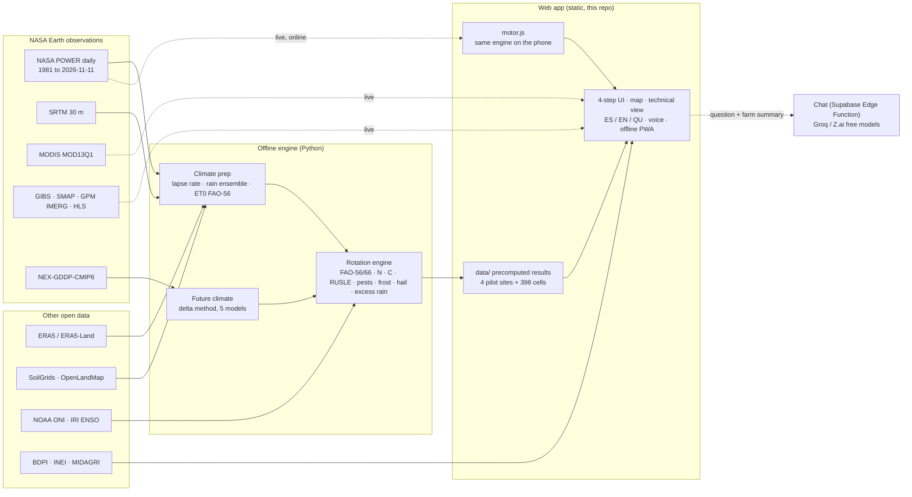

# Muyuy V1.0

**Crop rotations with NASA data for smallholder farmers on Peru's coast, highlands and rainforest.**

NASA Space Apps Challenge 2026 · Challenge: *Field Shift: Adapting Farms with NASA Data*

- 🌱 **Live app:** https://muyuy-innova.onrender.com
- 💻 **Repository:** https://github.com/patente012026/muyuy

> **En español:** Muyuy es una herramienta de apoyo a la decisión. Prueba miles de rotaciones de cultivos con 45 años de clima diario de NASA POWER (1981 al 11 de noviembre de 2026), corregido a la altura de cada chacra, y muestra tres opciones con su robustez frente al clima, su efecto en el suelo, sus razones y sus riesgos. Funciona en el celular, sin internet, en español, inglés y quechua. Muyuy muestra lo que dicen los datos; el agricultor decide.

---

## 1. What Muyuy does

Muyuy helps a farmer explore **what to rotate over the next three seasons**. The farmer picks their farm on a map (or finds it by community name), answers what they know (previous crop, priorities, frost, hail, soil texture, terraces, irrigation) and gets:

- **Three rotation options compared with what they grow today**, each with its robustness (*"works 6 years out of 10"*), its effect on soil nitrogen, organic carbon and erosion, its water use and income, **why it was suggested, the evidence behind it, where data are missing, and which risks need local review**.
- **A season plan** from planting to sale: planting window, dry days for harvest, frost nights for *chuño*, humidity for drying.
- **The El Niño forecast** (NOAA ONI and IRI-Columbia) and how each rotation behaved in past El Niño and La Niña years.
- **A 2041–2060 test** of every rotation with NASA NEX-GDDP-CMIP6.
- **"Build your own rotation"**, to compare the farmer's own idea with Muyuy's options.

**Muyuy is decision support, not a decision maker.** Each option card asks *"Would you try it on your farm?"*, and a *"Before you decide"* block reminds the farmer that the choice is theirs and that a local agronomist should review it.

---

## 2. Architecture



Muyuy has three layers:

1. **Offline engine (Python, run by the team).** It downloads the data, simulates every crop in every historical season and every three-season rotation, and writes compact results into `data/`. All of Peru is covered by **398 NASA POWER cells** (0.5° × 0.625°, about 55 km) plus 4 detailed pilot sites: Chinchero (Cusco), Ácora (Puno), Chulucanas (Piura) and Lamas (San Martín).
2. **Static web app (this repository).** HTML, CSS and plain JavaScript, with no framework and no build step on the server. It is an installable PWA (`manifest.json`, `sw.js`) that **works without internet** once opened. `Muyuy_sin_internet.html` is a single-file version that also works offline.
3. **Live services, used only when there is a connection.** With internet, `motor.js` downloads the exact farm's NASA POWER series and SoilGrids soil and runs **the same engine on the phone**, so any point in the world can be computed. The app also reads recent NASA data (POWER, MODIS, GIBS layers for SMAP, GPM IMERG and HLS) for the *"How is your farm now"* traffic light. A small chat answers questions using a summary of the farm.

---

## 3. NASA data used

| Dataset | What Muyuy uses it for | Period / resolution |
|---|---|---|
| **NASA POWER** Daily API (AG community) | Rain, Tmax, Tmin, humidity, wind and radiation: the base of the water balance, frost, ET₀ and the season plan | **1981-01-01 to 2026-11-11**, daily, 0.5° × 0.625° |
| **NASA POWER** Climatology API | Recent rain, soil moisture (GWETTOP) and Tmin against normal, for the current-season traffic light | 2001–2025 climatology |
| **SRTM** 30 m | Farm elevation (temperature correction) and slope (erosion, drainage) | Static |
| **MODIS Terra MOD13Q1** (ORNL DAAC) | Farm greenness (NDVI) 2001–2026 in the technical view | 250 m, 16-day; latest composite 2026-10-16 |
| **NASA GIBS** | Live map layers: SMAP L4 soil moisture, GPM IMERG rain, HLS true color, Blue Marble | Daily |
| **SMAP, GPM IMERG, HLS** | Recent soil moisture, rain and a recent image of the farm | Near real time |
| **NEX-GDDP-CMIP6** | 2041–2060 climate (SSP2-4.5 and SSP5-8.5; median of GFDL-ESM4, MPI-ESM1-2-HR, MRI-ESM2-0, IPSL-CM6A-LR and ACCESS-CM2) | 0.25°, aggregated to 0.5° |

**Other open data:** ERA5 and ERA5-Land (Copernicus, via Open-Meteo) to cross-check rain and minimum temperature; SoilGrids 2.0 (ISRIC) and OpenLandMap (Hengl et al., 2018) for soil; NOAA CPC ONI and IRI-Columbia for El Niño; PISCO (SENAMHI) and CHIRPS as rain references; BDPI (Ministry of Culture), INEI and geoBoundaries to find a farm by community or district; MIDAGRI (SIEA, SISAP and yearbooks) for yields and prices; FAO-56, FAO-66 and EcoCrop for crop parameters.

All data were downloaded and recalculated on **November 14–15, 2026**.

---

## 4. How the engine works

### 4.1 Climate preparation
- **Temperature** is corrected to the farm's elevation: `T_farm = T_POWER + Γ (z_farm − z_cell)`, with `Γ = −0.0065 °C/m`.
- **Rain:** NASA POWER tends to underestimate Andean rain and ERA5 to overestimate it, so the pilot sites use their geometric mean, `P = P_POWER × √(P_ERA5 / P_POWER)`. Map cells use a regional factor.
- **Frost:** gridded data smooth minimum temperatures, so Tmin is shifted (−4 to +2 °C) until the model reproduces the number of frost seasons the farmer remembers from the last five.
- **ET₀:** FAO-56 Penman-Monteith at the farm's elevation.

### 4.2 Soil
Available water comes from Saxton and Rawls (2006), using sand, clay and organic matter from SoilGrids. If the farmer describes the soil, that texture is blended in. Carbon and nitrogen stocks are derived from SoilGrids organic carbon, nitrogen and bulk density.

### 4.3 Rotation engine (three stages)
1. **Crop × season:** daily FAO-56 water balance (piecewise Kc, Ks stress), FAO-66 yield response (`1 − Ky × deficit`), frost loss in the sensitive phase, and excess rain with daily drainage by clay and slope (calibrated so that El Niño 1997–98 and 2016–17 still cause losses in Chulucanas).
2. **Sequence × window:** every three-season sequence (up to 16³ = 4,096 per region) runs through **43 overlapping historical windows** (45 seasons, 1981/82 to 2025/26). It tracks nitrogen carryover and fixation by legumes, pest pressure by botanical family (stronger for Solanaceae), hail, organic carbon with a tillage factor, **RUSLE** erosion and income.
3. **Scores (0–100):** water, income, soil and "not losing" (risk), combined with the weights the farmer chooses.

### 4.4 Definition of "works"
A season **works** when the water deficit is ≤ 30 %, frost and excess-rain losses are ≤ 25 % each, and nitrogen satisfaction is ≥ 80 %. A rotation works in a window when all three seasons work. **Robustness** is the share of windows in which it worked, told to the farmer as *"X years out of 10"* and drawn as ten squares. It is also split by El Niño or La Niña (December–February ONI) and by dry, normal or wet terciles.

### 4.5 Future climate and places outside Peru
The 2041–2060 change is applied with the **delta method** to each site's 45 years of daily data, which keeps El Niño and local variability. Outside Peru, Muyuy picks crops and planting months from each place's NASA POWER climatology, using a global table of 31 crops (FAO-56 and EcoCrop ranges). The demo includes 12 example farms in Africa, Asia and Latin America.

---

## 5. Farmer-centered design
- **Offline first:** precomputed results for all of Peru live in the app; no app store and no good connection are needed.
- **Three languages:** Spanish, English and Quechua, with recorded voice at every step.
- **Low-literacy friendly:** risk shown as "out of 10" with ten squares, never percentages; icons; short sentences. The conversation starts from the years the community remembers.
- **Andean knowledge:** the name and logic come from the Andean *muyuy* and *laymi* rotation systems, and a communal muyuy game supports village assemblies.
- **Transparency:** every number traces back to an equation and every crop parameter carries its source and confidence level. Limits are shown, not hidden.

---

## 6. Use of AI and privacy
AI is used **only to understand the farmer and talk with them; it never chooses the rotation.**

| Use | Tool | What it does not do |
|---|---|---|
| Chat *"Ask Muyuy"* | Free models through a Supabase Edge Function: Groq (gpt-oss-120b, Qwen, gpt-oss-20b) and Z.ai (GLM) | It does not calculate rotations or make up figures; it answers with the farm summary the phone builds |
| App voices | Piper (Spanish and English) and Meta MMS-TTS (Quechua draft), generated once and bundled | They read only the app's fixed texts |
| Illustrations | ChatGPT (OpenAI images) | No logos, text or real people |
| Development | Claude Code (coding, writing, translation drafts) | Every result was checked with tests, notebooks and human review |

Rotations are computed by the transparent engine described above, and explanations come from fixed templates in three languages. The chat sends only the question, the last messages and a farm summary, never a name or phone number. Model keys exist only as server secrets, and the server limits requests per IP (stored as a salted hash that is deleted after two days). Offline, the chat answers with the app's own texts.

---

## 7. Validation and known limitations
- **The ranking of rotations is stable** when thresholds and rain correction change, but **absolute robustness depends on rain**: with uncorrected NASA POWER data in Ácora, the first option drops from 6 to 2 years out of 10. That is why Muyuy presents a **comparison between rotations, not a yield forecast**. Calibrating rain with PISCO or SENAMHI stations is the main pending task.
- Rain in El Niño years was compared with SENAMHI stations in Piura: NASA POWER underestimates the extreme 1983 rain in Chulucanas.
- Working values still to be calibrated in the field: pest penalty, hail loss, N mineralization, tillage factor, soil-life index, prices and costs.
- Crops with low-confidence parameters (oca, olluco, mashua, tarwi, cañihua, kiwicha and the intercrops) are labeled in the app; oats with vetch must be validated with agronomists.
- Flood-irrigated rice and perennial crops (mango, coffee, cocoa) are not modeled. Excess rain is an index, not a flood simulation.
- The Quechua texts and voice are a **draft** until a native speaker reviews them.

---

## 8. Repository contents

| Path | What it is |
|---|---|
| `index.html` | The app (Muyuy V1.0), with a 4-step flow |
| `mapa.html` | National map of communities and risk layers |
| `tecnica.html` | Technical view for extension workers and judges: MODIS series, monthly climate, rotation cloud, water-deficit map, future climate and methods |
| `Muyuy_sin_internet.html` | Single-file offline version (about 48 MB) |
| `motor.js`, `motor_worker.js` | The rotation engine in JavaScript, for the exact farm computed on the phone |
| `*.js`, `*.css` | App modules (steps, map, satellites, chat, games, translations); `muyuy.min.js` and `muyuy.min.css` are the bundled versions |
| `data/` | Precomputed results: 4 pilot sites, 398 cells, risk map, future climate, El Niño, communities and boundaries |
| `audio/` | Bundled voices in Spanish, English and Quechua |
| `img/`, `lottie/`, `fonts/` | Images, animations and fonts |
| `sw.js`, `manifest.json` | Offline mode and installable app |
| `render.yaml` | Static-site configuration for Render |

### Run locally
It is a static site with no build step:

```
python -m http.server 8000
```

Then open http://localhost:8000.

---

## 9. Main references
- Allen, R. G. et al. (1998). *Crop evapotranspiration*. FAO Irrigation and Drainage Paper 56. https://www.fao.org/4/x0490e/x0490e00.htm
- Steduto, P. et al. (2012). *Crop yield response to water*. FAO Irrigation and Drainage Paper 66. https://www.fao.org/3/i2800e/i2800e.pdf
- Saxton, K. E. & Rawls, W. J. (2006). Soil water characteristic estimates by texture and organic matter. *Soil Science Society of America Journal* 70, 1569–1578.
- Poggio, L. et al. (2021). SoilGrids 2.0. *SOIL* 7, 217–240. https://doi.org/10.5194/soil-7-217-2021
- Thrasher, B. et al. (2022). NASA Global Daily Downscaled Projections, CMIP6. *Scientific Data* 9, 262. https://doi.org/10.1038/s41597-022-01393-4
- Navarro-Racines, C. et al. (2020). High-resolution and bias-corrected CMIP5 projections for climate change impact assessments. *Scientific Data* 7, 7. https://doi.org/10.1038/s41597-019-0343-8
- Ramirez-Villegas, J. et al. (2013). Implications of regional improvement in global climate models for agricultural impact research. *Agricultural and Forest Meteorology*. https://doi.org/10.1016/j.agrformet.2011.09.005
- Cai, W. et al. (2020). Climate impacts of the El Niño–Southern Oscillation on South America. *Nature Reviews Earth & Environment* 1, 215–231. https://doi.org/10.1038/s43017-020-0040-3
- Orlove, B. S. & Godoy, R. (1986). Sectoral fallowing systems in the Central Andes. *Journal of Ethnobiology* 6, 169–204.
- Rose, D. C. et al. (2016). Decision support tools for agriculture: towards effective design and delivery. *Agricultural Systems* 149, 165–174. https://doi.org/10.1016/j.agsy.2016.09.009

---

## 10. Credits and resources

Every external dataset, tool, library and service used to build Muyuy V1.0. All are open or free to use; AI-generated content is labeled where it appears.

### NASA data and resources
| Resource | Link |
|---|---|
| NASA POWER Daily API (AG community) | https://power.larc.nasa.gov/api/temporal/daily/point |
| NASA POWER Climatology API | https://power.larc.nasa.gov/api/temporal/climatology/point |
| SRTM 30 m elevation (SRTMGL1) | https://lpdaac.usgs.gov/products/srtmgl1v003/ |
| MODIS Terra MOD13Q1 vegetation index (ORNL DAAC) | https://modis.ornl.gov/rst/api/v1/MOD13Q1/subset |
| NASA GIBS imagery (SMAP L4, GPM IMERG, HLS, GEDI layers, Blue Marble) | https://gibs.earthdata.nasa.gov/ |
| SMAP L3 enhanced soil moisture | https://nsidc.org/data/spl3smp_e |
| GPM IMERG daily precipitation | https://disc.gsfc.nasa.gov/datasets/GPM_3IMERGDL_07/summary |
| HLS Landsat 30 m (HLSL30) | https://lpdaac.usgs.gov/products/hlsl30v002/ |
| HLS Sentinel-2 30 m (HLSS30) | https://lpdaac.usgs.gov/products/hlss30v002/ |
| GEDI L4B aboveground biomass | https://gedi.umd.edu/ |
| NEX-GDDP-CMIP6 future climate | https://www.nccs.nasa.gov/services/data-collections/land-based-products/nex-gddp-cmip6 |
| NASA Earthdata Login | https://urs.earthdata.nasa.gov |

### Space agency partner and other data
| Resource | Link |
|---|---|
| ERA5 / ERA5-Land (Copernicus), via Open-Meteo | https://archive-api.open-meteo.com/v1/archive |
| Copernicus DEM 90 m elevation, via Open-Meteo | https://open-meteo.com/en/docs/elevation-api |
| SoilGrids 2.0 (ISRIC) | https://rest.isric.org/soilgrids/v2.0/properties/query |
| OpenLandMap soil data (Hengl et al., 2018) | https://zenodo.org/records/2525663 |
| OpenTopoData SRTM API | https://api.opentopodata.org/v1/srtm30m |
| NOAA CPC Oceanic Niño Index (ONI) | https://www.cpc.ncep.noaa.gov/data/indices/oni.ascii.txt |
| IRI Columbia ENSO forecast | https://iri.columbia.edu/our-expertise/climate/forecasts/enso/current/ |
| PISCO rainfall, SENAMHI (planned calibration reference) | https://iridl.ldeo.columbia.edu/SOURCES/.SENAMHI/.HSR/.PISCO/ |
| CHIRPS rainfall (planned calibration reference) | https://www.chc.ucsb.edu/data/chirps |
| FAO EcoCrop | https://gaez.fao.org/pages/ecocrop |
| FAO-56 Crop evapotranspiration | https://www.fao.org/4/x0490e/x0490e00.htm |
| FAO-66 Crop yield response to water | https://www.fao.org/3/i2800e/i2800e.pdf |
| BDPI, Peru Ministry of Culture (communities) | https://bdpi.cultura.gob.pe/ |
| Peru Ubigeo dataset (INEI districts) | https://github.com/jmcastagnetto/ubigeo-peru-aumentado |
| geoBoundaries | https://www.geoboundaries.org/ |
| SIEA, MIDAGRI (yields) | https://siea.midagri.gob.pe/portal/ |
| SISAP, MIDAGRI (prices) | https://sistemas.midagri.gob.pe/sisap/portal2/ |

### AI tools (labeled in the app, slides and video)
| Tool | Use | Link |
|---|---|---|
| Claude (Anthropic) | Understands farmer messages (bot) | https://www.anthropic.com/claude |
| Claude Code | Coding, writing and translation drafts, with human review | https://www.anthropic.com/claude-code |
| Groq (gpt-oss, Qwen) and Z.ai (GLM) | Chat answers with the farm summary | https://groq.com · https://z.ai |
| faster-whisper | Voice-note transcription | https://github.com/SYSTRAN/faster-whisper |
| Piper TTS | Spanish and English app voices | https://github.com/rhasspy/piper |
| Meta MMS-TTS | Quechua app voice (draft) | https://huggingface.co/docs/transformers/model_doc/mms |
| ChatGPT (OpenAI) | Illustrations (watermarked) | https://chatgpt.com |
| ElevenLabs | Video narration and sound effects | https://elevenlabs.io |

### Software, libraries and services
| Resource | Link |
|---|---|
| Python | https://www.python.org |
| pandas | https://pandas.pydata.org |
| FastAPI | https://fastapi.tiangolo.com |
| fpdf2 | https://github.com/py-pdf/fpdf2 |
| Supabase (chat server) | https://supabase.com |
| Render (hosting) | https://render.com |
| Blender (video animation) | https://www.blender.org |
| Leaflet (maps) | https://leafletjs.com |
| Lottie (animations) | https://airbnb.io/lottie/ |

### Project materials
| Material | Link |
|---|---|
| Slides (7) | https://docs.google.com/presentation/d/1XgXZnF-bI5WHP3HmZcV2f1Th6NPrS6vd/edit?usp=sharing |
| 30-second video | https://www.youtube.com/watch?v=qgrn5PfF5tE |
| Complete technical document | https://docs.google.com/document/d/1c6tZS74QduESmwaEu8bIFEj1sPjIPzCG |

Field photos in the slides are real, taken with the farmers' permission in Chulucanas, Piura. The video music was synthesized by the team.

---

*Muyuy shows what the data say. The farmer decides.*
